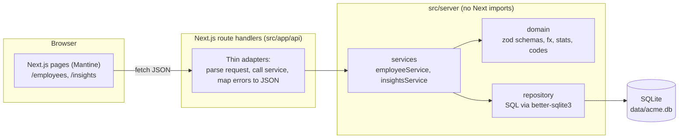
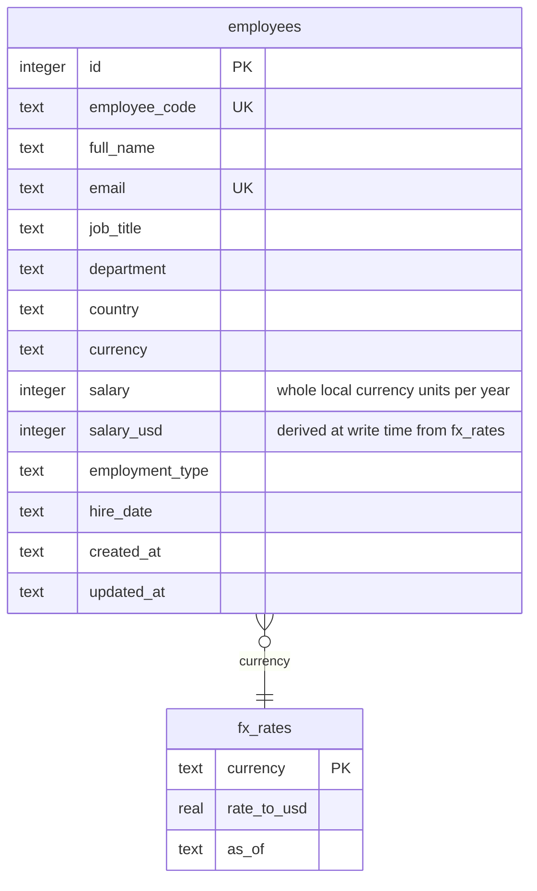

# Architecture

## Layers

- **domain**: pure functions and types (validation schema, USD normalisation, median/percentile, employee code format). No I/O.
- **repository**: all SQL. Receives a `Database` handle, so tests pass `:memory:`.
- **service**: use cases (list, create, update, delete, insights), maps DB constraint errors to domain errors (`NotFoundError`, `ConflictError`, `ValidationError`).
- **route handlers**: only translate HTTP <-> service calls. Error shape is always `{ error: { code, message, details? } }`.
- **UI**: client components fetch the JSON API (TanStack-free, plain `fetch` with small hooks); server-side pagination and filtering.

## Data model

Indexes: `country`, `department`, `job_title`, `(country, job_title)`, `salary_usd`, `hire_date`, `full_name`.

## API
| Method | Path | Notes |
|---|---|---|
| GET | `/api/employees` | `q, country, department, jobTitle, type, sort, order, page, pageSize` |
| POST | `/api/employees` | 201, 400 validation, 409 duplicate email |
| GET/PUT/DELETE | `/api/employees/:id` | 404 when missing |
| GET | `/api/insights/summary` | org totals |
| GET | `/api/insights/by-country` | local + USD stats |
| GET | `/api/insights/by-job-title?country=` | per-title stats in a country |
| GET | `/api/insights/by-department` | headcount, average USD |
| GET | `/api/insights/distribution` | USD histogram bands |
| GET | `/api/meta` | distinct countries, departments, job titles |

## Runtime database
`getDb()` opens `data/acme.db`. On Vercel (`process.env.VERCEL`) the bundled file is copied once to `/tmp/acme.db` (writable) and opened there. `npm run build` seeds the file, then runs `next build`; `outputFileTracingIncludes` ships it with the serverless functions.

## Performance notes
- 10,000 rows: filters hit indexes, `LIMIT/OFFSET` paging, a separate `COUNT(*)` for totals.
- Seed: single transaction + one prepared statement (well under a second).
- Insights: SQL `GROUP BY` for counts/min/max/avg; medians computed in TypeScript from one ordered column scan per group (cheap at this size; see decisions).
